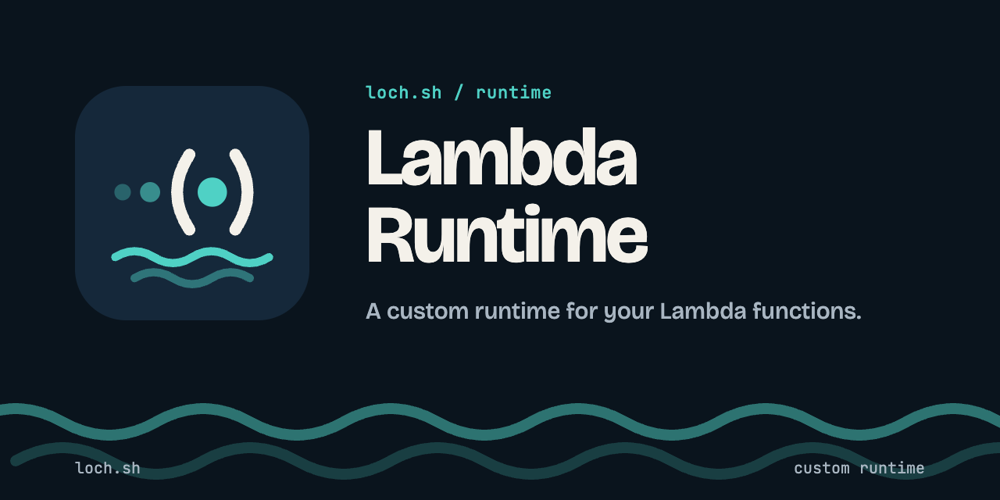

# loch lambda-runtime



Run AWS Lambda functions in plain Docker containers, with the official AWS
base images and unchanged handlers. No vendor lock-in: the runtime speaks
AWS's public protocols and knows nothing about the platform around it.

`loch-lambda-runtime` replaces the Runtime Interface Emulator (RIE) bundled in
the AWS base images. It is the container's PID 1:

- it serves the **Lambda Runtime API** (`2018-06-01`) to the image's bootstrap
  on `127.0.0.1:9001`;
- it serves the **Lambda Invoke API** (`POST /2015-03-31/functions/{name}/invocations`)
  on port 8080, so `aws lambda invoke --endpoint-url`, SAM and the AWS SDKs work;
- it runs exactly one invocation at a time, queues the others (429 when the
  queue is full), enforces the timeout, reports errors the AWS way
  (`X-Amz-Function-Error`), never truncates a payload, and never crashes on
  concurrent requests.

> Status: under development (v1). See [docs/spec.md](docs/spec.md).

## Quick start

Build the static Linux binaries (`dist/loch-lambda-runtime-linux-{amd64,arm64}`),
then run a Node.js function with the official AWS image, the runtime mounted
as its entrypoint:

```sh
make binaries
mkdir -p fn && echo 'exports.handler = async (event) => ({ hello: event.name ?? "world" });' > fn/index.js
ARCH=$(uname -m | sed 's/x86_64/amd64/;s/aarch64/arm64/')

docker run --rm -p 127.0.0.1:8080:8080 \
  -v "$PWD/dist/loch-lambda-runtime-linux-$ARCH:/loch/lambda-runtime:ro" \
  -v "$PWD/fn:/var/task:ro" \
  -e LOCH_RUNTIME_AUTH=off \
  --entrypoint /loch/lambda-runtime \
  public.ecr.aws/lambda/nodejs:22 index.handler
```

In another terminal:

```sh
curl localhost:8080/2015-03-31/functions/function/invocations -d '{"name":"you"}'
# {"hello":"you"}
```

`LOCH_RUNTIME_AUTH=off` is for this local try only: by default, the runtime
requires a credential (see below).

## Production run

What Loch.sh Panel does: credentials (only the SHA-256 of the bearer token
enters the container), and a read-only, non-root, capability-free, bounded
container.

```sh
# 1. Credentials (keep both values secret). fn/ and $ARCH as in the quick start.
TOKEN=$(openssl rand -hex 32)          # given to the callers, never to the container
TOKEN_SHA256=$(printf %s "$TOKEN" | openssl dgst -sha256 -r | cut -d' ' -f1)
KEY_ID=$(LC_ALL=C tr -dc A-Z0-9 </dev/urandom | head -c 20)  # optional SigV4 pair
KEY_SECRET=$(openssl rand -base64 30)
printf 'LOCH_RUNTIME_TOKEN_SHA256=%s\nLOCH_RUNTIME_ACCESS_KEY=%s:%s\n' "$TOKEN_SHA256" "$KEY_ID" "$KEY_SECRET" > fn.env
chmod 600 fn.env

# 2. The function container: read-only, non-root, no capability, bounded.
docker network create fn-net
docker run -d --name fn --network fn-net \
  --read-only --user 10001:10001 --cap-drop ALL --security-opt no-new-privileges:true \
  --tmpfs /tmp:size=64m --memory 256m --memory-swap 256m --cpus 0.5 --pids-limit 128 \
  -p 127.0.0.1:8080:8080 \
  -v "$PWD/dist/loch-lambda-runtime-linux-$ARCH:/loch/lambda-runtime:ro" \
  -v "$PWD/fn:/var/task:ro" \
  --env-file fn.env -e AWS_LAMBDA_FUNCTION_TIMEOUT=30 \
  --entrypoint /loch/lambda-runtime \
  public.ecr.aws/lambda/nodejs:22 index.handler
until docker exec fn /loch/lambda-runtime health >/dev/null; do sleep 0.2; done

# 3a. Invoke with curl and the bearer token.
curl -s -H "Authorization: Bearer $TOKEN" \
  localhost:8080/2015-03-31/functions/function/invocations -d '{"name":"curl"}'

# 3b. Invoke with the AWS CLI (SigV4), from a container on the same network.
docker run --rm --network fn-net \
  -e AWS_ACCESS_KEY_ID="$KEY_ID" -e AWS_SECRET_ACCESS_KEY="$KEY_SECRET" -e AWS_DEFAULT_REGION=us-east-1 \
  amazon/aws-cli:2.39.5 lambda invoke --endpoint-url http://fn:8080 --function-name function \
  --payload '{"name":"cli"}' --cli-binary-format raw-in-base64-out /dev/stdout

# 3c. Invoke from inside the container (what Loch.sh Panel does): the
#     loopback needs no credential.
echo '{"name":"exec"}' | docker exec -i fn /loch/lambda-runtime invoke --log-tail

# Logs (START/END/REPORT lines), health, cleanup.
docker logs fn
docker inspect --format '{{.State.Health.Status}}' fn
docker rm -f fn && docker network rm fn-net
```

See [Authentication](#authentication) for what the function's code can and
cannot read. For a healthcheck, prefer compose and its exec form
(`test: ["CMD", "/loch/lambda-runtime", "health"]`): `docker run
--health-cmd` only has the shell form (see below).

## Command line

```
loch-lambda-runtime [run] [flags] -- <command> [args...]   # the image ENTRYPOINT and CMD
loch-lambda-runtime [run] [flags] <handler>                # = /lambda-entrypoint.sh <handler>
loch-lambda-runtime health                                 # exit 0 when ready (compose healthcheck)
loch-lambda-runtime invoke [--timeout <s>] [--log-tail]    # event on stdin, JSON envelope on stdout
loch-lambda-runtime version
```

Use `run` explicitly if your handler is literally named `health`, `invoke` or
`version`.

Write the healthcheck in exec form (`["CMD", "/loch/lambda-runtime",
"health"]`), not `CMD-SHELL`: a shell would hold the container's
environment in a process the function can read.

The function's code is untrusted: it can forge `START`/`END`/`REPORT` lines
in its own output, so never derive billing or health from the logs (use
`/_loch/metrics`, the `invoke` envelope or `/_loch/health`). See the threat
model in [docs/spec.md](docs/spec.md).

## Configuration

Every `LOCH_RUNTIME_*` variable also exists as a flag (`--queue-size`, …);
flags win. Invalid values stop the runtime at startup with a message naming the
setting.

| Variable | Default | Meaning |
|---|---|---|
| `LOCH_RUNTIME_INVOKE_ADDR` | `0.0.0.0:8080` | Invoke API listen address |
| `LOCH_RUNTIME_API_ADDR` | `127.0.0.1:9001` | Runtime API listen address (loopback only) |
| `LOCH_RUNTIME_HEALTH_ADDR` | `127.0.0.1:8081` | health-only listener used by `health` (loopback only) |
| `LOCH_RUNTIME_BOOTSTRAP` | `/lambda-entrypoint.sh` | program of the `<handler>` shortcut |
| `LOCH_RUNTIME_WORKDIR` | current directory (the image `WORKDIR`) | working directory of the bootstrap |
| `LOCH_RUNTIME_INIT_TIMEOUT` | `10s` | init budget before it is charged to the first invocation |
| `LOCH_RUNTIME_SHUTDOWN_GRACE` | `8s` | time given to the running invocation on SIGTERM |
| `LOCH_RUNTIME_MAX_PAYLOAD` | `6MiB` | request limit (responses: + 100 bytes, as Lambda) |
| `LOCH_RUNTIME_QUEUE_SIZE` | `16` | waiting invocations |
| `LOCH_RUNTIME_QUEUE_BYTES` | `min(32MiB, memory/8)` | total size of waiting invocations |
| `LOCH_RUNTIME_QUEUE_TIMEOUT` | `30s` | maximum wait in the queue |
| `LOCH_RUNTIME_MAX_CONNS` | 8 × (queue size + 1), at most 768 | open connections to the Invoke API (an eighth per source IP, at least 4) |
| `LOCH_RUNTIME_AUTH` | `on` | `off` (or `false`) disables authentication (development only) |
| `LOCH_RUNTIME_ALLOW_BROWSER` | `false` | `true` accepts requests from web browsers (`Origin`, `Sec-Fetch-Site`, `Sec-Fetch-Dest`, `Sec-Fetch-User`) |
| `LOCH_RUNTIME_TOKEN_SHA256` | | hex SHA-256 of the bearer token (recommended) |
| `LOCH_RUNTIME_TOKEN_SHA256_FILE` | | file holding it |
| `LOCH_RUNTIME_TOKEN` | | plain bearer token (standalone use: readable by the function) |
| `LOCH_RUNTIME_TOKEN_FILE` | | file holding the plain bearer token |
| `LOCH_RUNTIME_ACCESS_KEY` | | `<access key id>:<secret>` for SigV4, optional (readable by the function) |
| `LOCH_RUNTIME_ACCESS_KEY_FILE` | | file holding `<access key id>:<secret>` for SigV4 |
| `LOCH_RUNTIME_LOG_LEVEL` | `info` | `debug`, `info`, `warn`, `error` |

Durations accept Go syntax (`1m30s`) or seconds (`2.5`); sizes accept bytes or
a `KiB`/`MiB`/`GiB` suffix.

Function settings use the AWS variables: `AWS_LAMBDA_FUNCTION_NAME` (default
`function`), `AWS_LAMBDA_FUNCTION_VERSION` (`$LATEST`), `AWS_LAMBDA_FUNCTION_TIMEOUT`
(seconds, default 300; an RIE convention, not an AWS variable),
`AWS_LAMBDA_FUNCTION_MEMORY_SIZE` (default: the cgroup memory limit, else 3008),
`AWS_REGION` (default `us-east-1`).

The bootstrap receives the inherited environment, plus the variables a Lambda
runtime expects when they are absent (`AWS_LAMBDA_LOG_GROUP_NAME`,
`AWS_LAMBDA_LOG_STREAM_NAME`, `AWS_DEFAULT_REGION`, `LAMBDA_TASK_ROOT`, …).
`AWS_LAMBDA_RUNTIME_API` is always forced to the Runtime API, and
`AWS_LAMBDA_MAX_CONCURRENCY` and every `LOCH_RUNTIME_*` variable are always
removed. No credential is ever invented.

## Authentication

Network callers must authenticate; the runtime refuses to start without a
credential (`LOCH_RUNTIME_AUTH=off` disables this, for local development
only). Callers on the loopback (the function itself, `docker exec`
processes such as `invoke` and `health`) need none.

Never run the container with `--network host`: the loopback exemption
assumes the container has its own network namespace. With the host's,
every local process of the host could invoke the function and read its
metrics without a credential.

- **Bearer token, configured as its SHA-256** (recommended):
  `LOCH_RUNTIME_TOKEN_SHA256` (64 hex) or `LOCH_RUNTIME_TOKEN_SHA256_FILE`.
  Callers send `Authorization: Bearer <token>`; the runtime compares hashes
  in constant time. The token itself is never in the container.
- A plain token (`LOCH_RUNTIME_TOKEN` or `LOCH_RUNTIME_TOKEN_FILE`, 32 bytes
  at least) works too, for standalone use only: the function's code runs
  under the same uid and can read it in the environment of the
  `docker exec` processes (`/proc/<pid>/environ`).
- **AWS SigV4**, optional, so the AWS CLI and SDKs work unchanged:
  `LOCH_RUNTIME_ACCESS_KEY` or `LOCH_RUNTIME_ACCESS_KEY_FILE`
  (`<access key id>:<secret>`). HMAC needs the secret itself, so **the
  function can read its own SigV4 secret**: that only lets it invoke
  itself. Never present that secret as protected from the function's code.

```sh
AWS_ACCESS_KEY_ID=… AWS_SECRET_ACCESS_KEY=… aws lambda invoke \
  --endpoint-url http://fn:8080 --function-name function \
  --payload '{"hello":"world"}' --cli-binary-format raw-in-base64-out out.json
```

Credentials from the environment are read once, then removed from the
runtime's environment; the `*_FILE` variants (regular files) are re-read on
SIGHUP: rotate by renaming a complete new file over the old one. A reload
that fails keeps the credentials in force, so writing an invalid credential
revokes nothing: to revoke, restart with new credentials. One source per
credential. Generate the access key id at random and keep it private too.

Mount the credential files read-only (Docker secrets, or a `:ro` bind
mount). The function runs under the runtime's user and can send it SIGHUP,
so the runtime refuses a credential file that this user could change: the
file and every directory above it must be on a read-only mount, or belong
to another user without being writable by the runtime. A world-writable
file is refused too. Run the runtime as a non-root user (the image uses
uid 10001): as root, the whole path, rootfs included, must be read-only.

Requests from web browsers (an `Origin`, `Sec-Fetch-Site`,
`Sec-Fetch-Dest` or `Sec-Fetch-User` header) are refused with 403, even
with authentication off: a web page could otherwise make a browser invoke
the function (CSRF, DNS rebinding). SDKs, the AWS CLI, curl and Node's
`fetch` are not affected. A reverse proxy forwarding a browser's `Origin`
is refused too: strip the header at the proxy, or set
`LOCH_RUNTIME_ALLOW_BROWSER=true`.

SigV4 requests can be replayed within the ±5 min clock skew, and the Invoke
API is plain HTTP: expose it on private networks only.

`/_loch/health` needs no credential; `/_loch/metrics` (Prometheus text
format) does, except from the loopback.

### Local invoke

`invoke` reads the event on stdin and prints a JSON envelope (`statusCode`,
`functionError`, `requestId`, `durationMs`, base64 `payload` and `logTail`):

```sh
echo '{"hello":"world"}' | docker exec -i fn /loch/lambda-runtime invoke --log-tail
```

It always ends by its deadline: `--timeout`, by default the function timeout
\+ `LOCH_RUNTIME_QUEUE_TIMEOUT` + 5 s (the event must arrive on stdin within
10 s). Docker cannot kill an exec process and does not close its stdout when
the client goes away, but it closes its stdin: with `--watch-stdin`, the
event is the first JSON value on stdin, **ended by a newline** (a number or
`true`/`null` cannot end otherwise while stdin stays open), the caller
keeps stdin open, and `invoke` ends within a second once stdin closes. Exit codes: 0 delivered
(whatever the function returned), 1 transport error or caller gone, 2
unusable event.

## Not supported (v1)

Extensions and Telemetry APIs (layer extensions in `/opt/extensions` are not
started), response streaming to the client (streamed responses are buffered),
SnapStart, X-Ray export, asynchronous `Event` invocations (400),
`Lambda-Runtime-Invocation-Id`. `Max Memory Used` is the container's peak
since it started, not the invocation's.

## Development

```sh
make test         # unit tests (race detector)
make integration  # against the real AWS images (Docker)
make test-linux   # unit tests in a Linux container
make cover        # coverage
make release      # static binaries, SBOMs, SHA256SUMS (signing: docs/release.md)
make reproducible # two builds in two directories give the same sha256
```

## License

Apache License 2.0, see [LICENSE](LICENSE) and [NOTICE](NOTICE).
